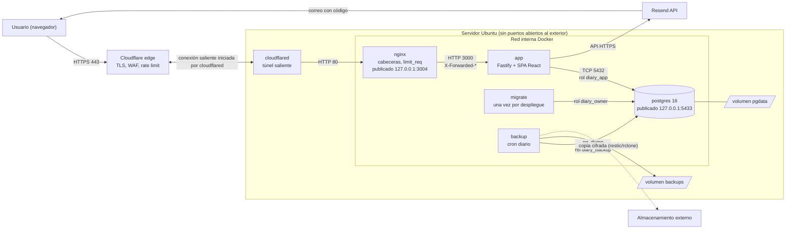
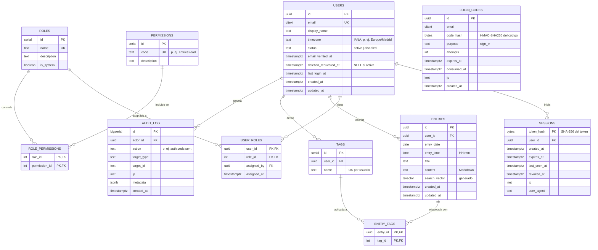
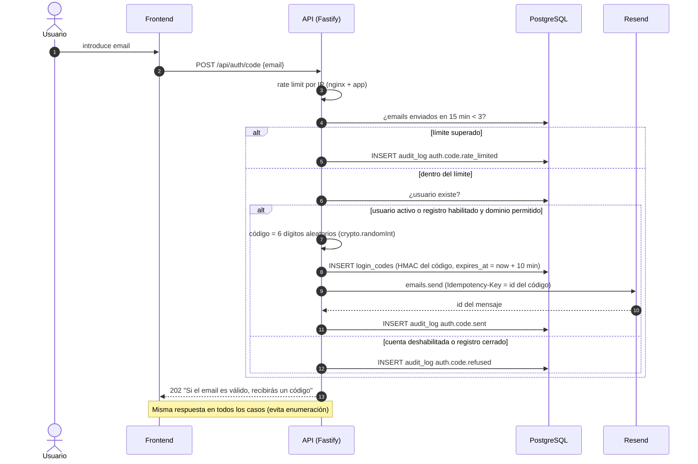
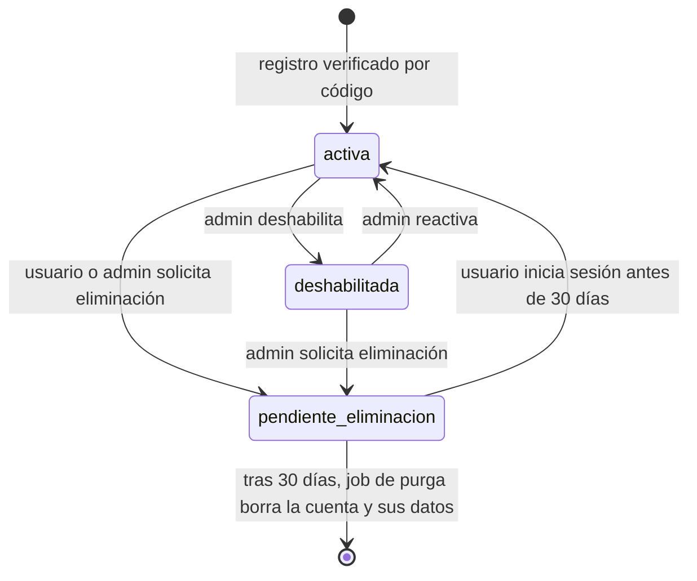
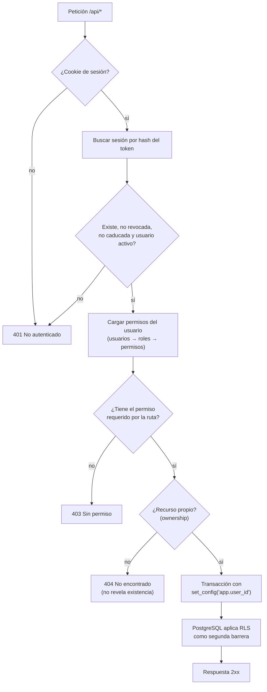
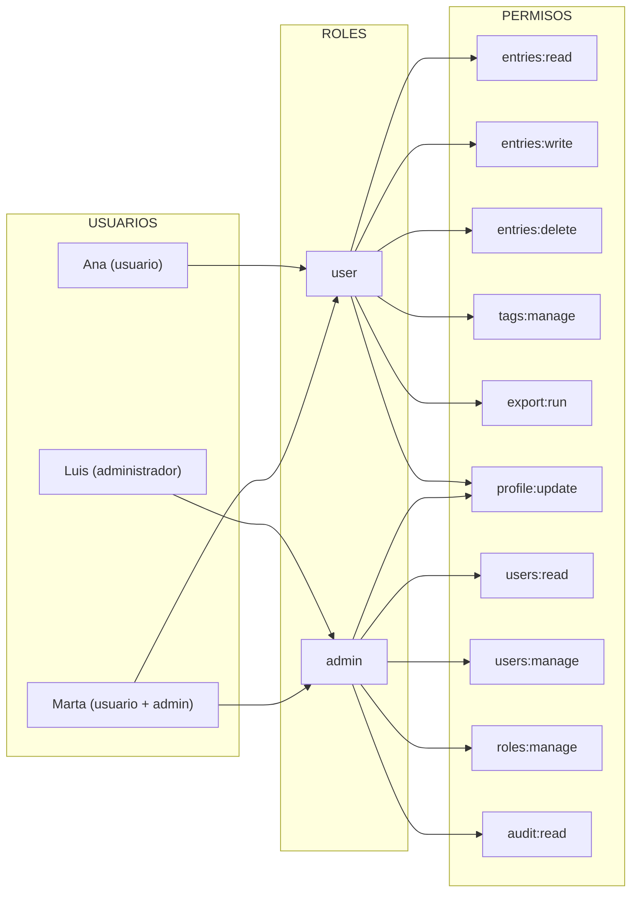
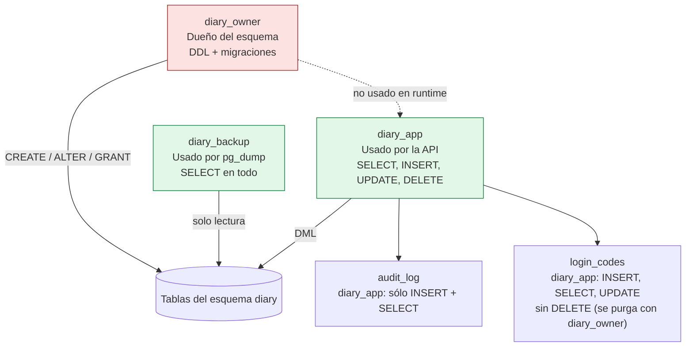
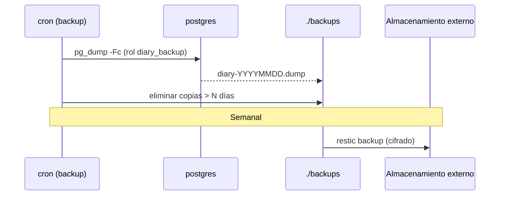

# Plan de arquitectura y desarrollo: Diario personal

## 1. Resumen

Aplicación web para escribir notas organizadas por fecha y hora, como un diario personal.
Es multiusuario, con registro e inicio de sesión por correo electrónico (sin contraseñas), roles y permisos.
Se despliega en un servidor Ubuntu con contenedores Docker, PostgreSQL como base de datos, Nginx como punto de entrada y Resend para el envío de correos.

**Stack propuesto**

| Capa                 | Tecnología                                           | Motivo                                                                                                              |
| -------------------- | ---------------------------------------------------- | ------------------------------------------------------------------------------------------------------------------- |
| Runtime              | Node.js 22 LTS                                       | Soporte a largo plazo                                                                                               |
| Lenguaje             | TypeScript (modo `strict`)                           | Tipado en backend y frontend                                                                                        |
| Backend              | Fastify                                              | Rápido, buen soporte de TypeScript y validación con JSON Schema                                                     |
| Frontend             | React + Vite                                         | Build rápido y SPA sencilla                                                                                         |
| Estilos              | Tailwind CSS v4                                      | Utilidades CSS, sin ficheros de estilos por componente                                                              |
| Internacionalización | i18next (`react-i18next`)                            | Textos en español por defecto, preparado para más idiomas                                                           |
| Base de datos        | PostgreSQL 16                                        | Relacional, roles y permisos nativos, RLS, búsqueda full-text                                                       |
| Acceso a datos       | Drizzle ORM + driver `pg`                            | Tipado de esquema, migraciones versionadas                                                                          |
| Validación           | Zod (compartido front/back)                          | Un único esquema para validar datos                                                                                 |
| Correo transaccional | Resend (SDK `resend`)                                | API simple, dominio propio, SPF/DKIM                                                                                |
| Códigos de acceso    | HMAC-SHA256 con secreto de servidor (`node:crypto`)  | Códigos de 6 dígitos de un solo uso, almacenados como hash                                                          |
| Sesiones             | Cookie `httpOnly` + tabla `sessions` en PostgreSQL   | Sesiones revocables en cualquier momento                                                                            |
| Autorización         | RBAC (usuarios → roles → permisos) + ownership + RLS | Control por permisos y aislamiento entre usuarios                                                                   |
| Exposición pública   | Cloudflare Tunnel (`cloudflared`) + Nginx            | HTTPS gestionado por Cloudflare, sin puertos abiertos en el servidor; Nginx como proxy interno y limitación de tasa |
| Tests                | Vitest (unitarios e integración), Playwright (e2e)   | Herramientas nativas de TS                                                                                          |
| Contenedores         | Docker multi-stage + Docker Compose                  | Build reproducible y despliegue simple                                                                              |

---

## 2. Requisitos

### 2.1 Funcionales

- **RF-01** Crear, editar y borrar notas propias.
- **RF-02** Cada nota tiene **fecha y hora** (hora y minutos). Por defecto, la fecha y hora actuales en la zona horaria del usuario. Puede haber varias notas el mismo día; se ordenan por hora.
- **RF-03** Vista de calendario y lista cronológica por día.
- **RF-04** Vista "Hoy": abrir rápidamente la nota del día o crear una nueva.
- **RF-05** Búsqueda de texto en las notas propias.
- **RF-06** Editor Markdown con vista previa.
- **RF-07** Etiquetas propias por nota.
- **RF-08** **Registro por correo electrónico**: el usuario introduce su email y nombre; recibe un código para confirmar la cuenta. No se crean contraseñas.
- **RF-09** **Inicio de sesión sin contraseña**: el usuario introduce su email, recibe un código de 6 dígitos por correo y lo introduce para entrar.
- **RF-10** Cierre de sesión y cierre de sesiones en otros dispositivos ("Mis sesiones").
- **RF-11** Perfil: nombre visible y zona horaria.
- **RF-12** Roles y permisos: el administrador gestiona usuarios (activar, desactivar, eliminar) y roles. Los usuarios sólo acceden a sus propias notas.
- **RF-13** Auditoría de accesos, cambios de rol y acciones sensibles.
- **RF-14** Exportar las notas propias (JSON y Markdown).
- **RF-15** Eliminación de cuenta con periodo de gracia de 30 días, cancelable al volver a iniciar sesión.

### 2.2 No funcionales

- **RNF-01** Privacidad: los datos sólo residen en el servidor propio. Ningún rol (ni el administrador) puede leer las notas de otro usuario. Resend sólo recibe el email del destinatario y el contenido del correo de acceso.
- **RNF-02** Seguridad: HTTPS, cookies seguras, cabeceras de seguridad, limitación de tasa por IP y por email, códigos de un solo uso con caducidad.
- **RNF-03** Despliegue reproducible: `docker compose up -d` levanta todo el stack.
- **RNF-04** Persistencia: PostgreSQL con volumen dedicado y copias de seguridad automáticas.
- **RNF-05** Copias diarias (`pg_dump`) con retención configurable y copia externa cifrada.
- **RNF-06** Mínimo privilegio, también en la base de datos (roles de PostgreSQL separados).
- **RNF-07** Entregabilidad del correo: dominio verificado en Resend con SPF, DKIM y DMARC.
- **RNF-08** Accesibilidad básica (teclado, contraste AA) y diseño responsive.
- **RNF-09** Exposición mínima: el servidor no tiene puertos HTTP/HTTPS abiertos al exterior; el tráfico público entra únicamente por el túnel de Cloudflare y los puertos locales (3004, 5433) están ligados a `127.0.0.1`.

---

## 3. Arquitectura

### 3.1 Vista general



Contenedores:

1. **cloudflared**: mantiene el túnel saliente hacia Cloudflare y reenvía el tráfico del dominio público a nginx. No requiere abrir puertos en el router ni en el servidor.
2. **nginx**: proxy interno. Aplica cabeceras, limita peticiones a `/api/auth/*` y reenvía a `app`. Se publica sólo en `127.0.0.1:3004` (útil para diagnóstico local).
3. **app**: API (`/api`) y ficheros estáticos del frontend compilado. Sólo accesible desde nginx.
4. **postgres**: PostgreSQL 16. Dentro de Docker escucha en 5432; en el host se publica como **`127.0.0.1:5433`**, sólo para herramientas locales.
5. **migrate**: ejecuta las migraciones con `diary_owner` y termina.
6. **backup**: cron que ejecuta `pg_dump` y rota las copias.

Servicios externos: **Cloudflare** (DNS, HTTPS público, túnel) y **Resend** (correo transaccional).

Puertos del servidor:

| Puerto   | Protocolo | Enlace                           | Uso                                                                         |
| -------- | --------- | -------------------------------- | --------------------------------------------------------------------------- |
| 3004     | HTTP      | `127.0.0.1:3004 → nginx:80`      | Entrada local de nginx (diagnóstico y cloudflared si se ejecuta en el host) |
| 5433     | TCP       | `127.0.0.1:5433 → postgres:5432` | Acceso local a PostgreSQL (cliente, pruebas)                                |
| 80 / 443 | —         | no publicados                    | HTTPS lo termina Cloudflare; no se abren al exterior                        |

### 3.2 Estructura del repositorio

```
diary/
├── docs/
│   └── PLAN.md
├── src/
│   ├── server/
│   │   ├── index.ts               # Arranque del servidor
│   │   ├── app.ts                 # Construcción de la instancia Fastify (testeable)
│   │   ├── config.ts              # Variables de entorno validadas (Zod)
│   │   ├── plugins/               # session, authorize, rate-limit, security-headers
│   │   ├── routes/                # auth, account, entries, tags, export, admin, health
│   │   ├── services/              # auth-code, sessions, entries, users, audit
│   │   ├── mail/
│   │   │   ├── mailer.ts          # Interfaz MailService
│   │   │   ├── resend-mailer.ts   # Implementación con Resend
│   │   │   ├── console-mailer.ts  # Implementación de desarrollo (imprime el código)
│   │   │   └── templates/         # Plantillas del correo de acceso (ES)
│   │   ├── repositories/          # Acceso a datos (Drizzle)
│   │   ├── security/              # HMAC de códigos, tokens de sesión, permisos
│   │   └── db/
│   │       ├── schema.ts          # Esquema Drizzle
│   │       ├── migrations/        # Migraciones versionadas
│   │       ├── rls.sql            # Políticas Row Level Security
│   │       ├── seed.ts            # Permisos y roles del sistema
│   │       ├── migrate.ts         # Ejecuta migraciones (contenedor migrate)
│   │       └── client.ts          # Pool de conexiones (pg)
│   ├── client/
│   │   ├── routes/                # Login, Verificar código, Hoy, Calendario, Día, Búsqueda, Cuenta, Admin
│   │   ├── components/
│   │   ├── api/                   # Cliente HTTP tipado
│   │   └── styles/                # index.css con @import "tailwindcss"
│   └── shared/                    # Esquemas Zod y tipos compartidos
├── tests/
│   ├── unit/
│   ├── integration/               # Fastify + PostgreSQL real (Testcontainers)
│   └── e2e/                       # Playwright
├── deploy/
│   ├── nginx/
│   │   ├── nginx.conf
│   │   ├── proxy_params.conf
│   │   └── conf.d/diary.conf      # Servidor HTTP interno (TLS lo termina Cloudflare)
│   └── postgres/
│       ├── init-roles.sh          # Crea roles diary_app y diary_backup (primer arranque)
│       └── grant-privileges.sql   # Privilegios de los roles sobre la base de datos
├── scripts/
│   └── backup/                    # Imagen de backup (Dockerfile + backup.sh)
├── Dockerfile
├── docker-compose.yml
├── docker-compose.dev.yml
├── .env.example
└── package.json
```

---

### 3.3 Convenciones de código e idioma

| Elemento                                        | Idioma                   | Ejemplo                                            |
| ----------------------------------------------- | ------------------------ | -------------------------------------------------- |
| Código (variables, funciones, clases, ficheros) | Inglés                   | `createEntry`, `login-codes.repository.ts`         |
| Comentarios y JSDoc                             | Inglés                   | `// Hash the code so a DB dump cannot be replayed` |
| Nombres de tablas, columnas y endpoints         | Inglés                   | `entries`, `entry_time`, `/api/entries`            |
| Mensajes de commit, PRs, issues                 | Inglés                   | `feat(auth): add email code verification`          |
| Mensajes de error de la API (códigos de error)  | Inglés                   | `INVALID_CODE`, `ACCOUNT_DISABLED`                 |
| Textos visibles para el usuario                 | Español, vía i18n (`es`) | "Te hemos enviado un código"                       |
| Plantillas de correo (contenido)                | Español, vía i18n        | Asunto y cuerpo en español                         |
| Documentación del proyecto (`docs/`, README)    | Español                  | Este documento                                     |

Reglas:

- Ningún texto visible está escrito directamente en un componente: todo pasa por claves de i18n (`src/client/locales/es.json`, `en.json` cuando llegue).
- Los documentos de `docs/` se mantienen en español; el código y sus comentarios, en inglés.

---

## 4. Modelo de datos (PostgreSQL)

### 4.1 Diagrama entidad-relación



### 4.2 Decisiones de modelo

- **Sin contraseñas**: la tabla `users` no tiene `password_hash`. La identidad es el email, verificado en cada inicio de sesión.
- **Fecha y hora de la nota**: `entry_date` (`date`) y `entry_time` (`time`, precisión de minutos; se guarda `HH:mm`). La combinación determina el orden dentro del día. Como la hora es "de pared", se interpreta en la zona horaria del usuario (`users.timezone`), por eso no se usa `timestamptz` para la nota.
- **Marcas de tiempo del sistema** (`created_at`, `updated_at`, `expires_at`): `timestamptz` en UTC.
- **Códigos de acceso**: 6 dígitos, válidos 10 minutos, un solo uso, máximo 5 intentos. Se guarda `HMAC-SHA256(secreto_servidor, código)`, no el código. Como el espacio de códigos es pequeño (10⁶), el secreto del servidor impide validar códigos a partir de un volcado de la base de datos.
- **Sesiones**: se guarda sólo el hash SHA-256 del token aleatorio de 32 bytes; el token viaja en la cookie.
- **Etiquetas**: únicas por usuario (`UNIQUE (user_id, name)`).
- **Búsqueda**: `search_vector tsvector GENERATED ALWAYS AS (...) STORED`, con índice GIN y configuración `spanish`.
- **Auditoría**: tabla append-only; `diary_app` no puede `UPDATE` ni `DELETE` sobre ella.
- **Zona horaria**: detectada en el navegador al iniciar sesión por primera vez y editable en el perfil. Valor por defecto `UTC`.
- **Eliminación**: marcar `deletion_requested_at` no borra nada; al cumplirse 30 días, un job de purga con `diary_owner` elimina la cuenta y, por cascada, sus notas, etiquetas y sesiones. Los registros de `audit_log` se conservan con `actor_id` a `NULL`.

### 4.3 Esquema SQL de referencia

```sql
CREATE EXTENSION IF NOT EXISTS pgcrypto;  -- gen_random_uuid()
CREATE EXTENSION IF NOT EXISTS citext;    -- emails sin distinguir mayúsculas

CREATE TABLE users (
  id                uuid PRIMARY KEY DEFAULT gen_random_uuid(),
  email             citext NOT NULL UNIQUE,
  display_name      text NOT NULL CHECK (char_length(display_name) BETWEEN 1 AND 60),
  timezone          text NOT NULL DEFAULT 'UTC',
  status            text NOT NULL DEFAULT 'active' CHECK (status IN ('active','disabled')),
  email_verified_at timestamptz NOT NULL DEFAULT now(),
  last_login_at     timestamptz,
  deletion_requested_at timestamptz,         -- NULL = cuenta activa; si no es NULL, borrado programado (30 días)
  created_at        timestamptz NOT NULL DEFAULT now(),
  updated_at        timestamptz NOT NULL DEFAULT now()
);

CREATE TABLE login_codes (
  id          uuid PRIMARY KEY DEFAULT gen_random_uuid(),
  email       citext NOT NULL,
  code_hash   bytea NOT NULL,
  purpose     text NOT NULL DEFAULT 'sign_in' CHECK (purpose IN ('sign_in')),
  attempts    integer NOT NULL DEFAULT 0,
  expires_at  timestamptz NOT NULL,
  consumed_at timestamptz,
  ip          inet,
  created_at  timestamptz NOT NULL DEFAULT now()
);
CREATE INDEX login_codes_email_idx ON login_codes(email, created_at DESC);

CREATE TABLE roles (
  id          serial PRIMARY KEY,
  name        text NOT NULL UNIQUE,
  description text,
  is_system   boolean NOT NULL DEFAULT false
);

CREATE TABLE permissions (
  id          serial PRIMARY KEY,
  code        text NOT NULL UNIQUE,            -- recurso:acción
  description text
);

CREATE TABLE role_permissions (
  role_id       integer NOT NULL REFERENCES roles(id) ON DELETE CASCADE,
  permission_id integer NOT NULL REFERENCES permissions(id) ON DELETE CASCADE,
  PRIMARY KEY (role_id, permission_id)
);

CREATE TABLE user_roles (
  user_id     uuid NOT NULL REFERENCES users(id) ON DELETE CASCADE,
  role_id     integer NOT NULL REFERENCES roles(id) ON DELETE RESTRICT,
  assigned_by uuid REFERENCES users(id) ON DELETE SET NULL,
  assigned_at timestamptz NOT NULL DEFAULT now(),
  PRIMARY KEY (user_id, role_id)
);

CREATE TABLE sessions (
  token_hash   bytea PRIMARY KEY,
  user_id      uuid NOT NULL REFERENCES users(id) ON DELETE CASCADE,
  created_at   timestamptz NOT NULL DEFAULT now(),
  expires_at   timestamptz NOT NULL,
  last_seen_at timestamptz NOT NULL DEFAULT now(),
  revoked_at   timestamptz,
  ip           inet,
  user_agent   text
);
CREATE INDEX sessions_user_idx ON sessions(user_id) WHERE revoked_at IS NULL;

CREATE TABLE entries (
  id            uuid PRIMARY KEY DEFAULT gen_random_uuid(),
  user_id       uuid NOT NULL REFERENCES users(id) ON DELETE CASCADE,
  entry_date    date NOT NULL,
  entry_time    time(0) NOT NULL,            -- HH:mm (segundos a 0)
  title         text,
  content       text NOT NULL DEFAULT '',
  search_vector tsvector GENERATED ALWAYS AS (
                  setweight(to_tsvector('spanish', coalesce(title,'')), 'A') ||
                  setweight(to_tsvector('spanish', content), 'B')
                ) STORED,
  created_at    timestamptz NOT NULL DEFAULT now(),
  updated_at    timestamptz NOT NULL DEFAULT now(),
  CHECK (extract(second from entry_time) = 0)  -- date_trunc does not accept time values
);
CREATE INDEX entries_user_day_idx ON entries(user_id, entry_date, entry_time);
CREATE INDEX entries_search_idx ON entries USING GIN (search_vector);

CREATE TABLE tags (
  id      serial PRIMARY KEY,
  user_id uuid NOT NULL REFERENCES users(id) ON DELETE CASCADE,
  name    text NOT NULL,
  UNIQUE (user_id, name)
);

CREATE TABLE entry_tags (
  entry_id uuid    NOT NULL REFERENCES entries(id) ON DELETE CASCADE,
  tag_id   integer NOT NULL REFERENCES tags(id) ON DELETE CASCADE,
  PRIMARY KEY (entry_id, tag_id)
);

CREATE TABLE audit_log (
  id          bigserial PRIMARY KEY,
  actor_id    uuid REFERENCES users(id) ON DELETE SET NULL,
  action      text NOT NULL,                  -- p. ej. auth.code.sent
  target_type text,
  target_id   text,
  ip          inet,
  metadata    jsonb NOT NULL DEFAULT '{}'::jsonb,
  created_at  timestamptz NOT NULL DEFAULT now()
);
CREATE INDEX audit_actor_idx ON audit_log(actor_id, created_at);
```

---

## 5. Autenticación sin contraseña

### 5.1 Registro e inicio de sesión

Registro e inicio de sesión usan el mismo flujo: **email + código**. Si el email no existe y el registro está habilitado, la cuenta se crea al verificar el código.

Parámetros configurables:

| Variable                | Valor por defecto | Función                                                                                          |
| ----------------------- | ----------------- | ------------------------------------------------------------------------------------------------ |
| `REGISTRATION_ENABLED`  | `true`            | Permite crear cuentas nuevas. Se recomienda ponerlo a `false` tras crear las cuentas necesarias. |
| `ALLOWED_EMAIL_DOMAINS` | vacío             | Lista opcional de dominios permitidos para registro.                                             |
| `CODE_TTL_MINUTES`      | `10`              | Caducidad del código.                                                                            |
| `CODE_MAX_ATTEMPTS`     | `5`               | Intentos por código antes de invalidarlo.                                                        |
| `CODE_REQUEST_LIMIT`    | `3 / 15 min`      | Códigos máximos por email en ese intervalo.                                                      |

### 5.2 Flujo: solicitar código



### 5.3 Flujo: verificar código e iniciar sesión

```mermaid
sequenceDiagram
    autonumber
    actor U as Usuario
    participant F as Frontend
    participant A as API (Fastify)
    participant DB as PostgreSQL

    U->>F: introduce código de 6 dígitos
    F->>A: POST /api/auth/code/verify {email, code, timezone?}
    A->>DB: SELECT último código activo del email (no consumido, no caducado)
    alt no hay código activo
        A-->>F: 401 código no válido o caducado
    else código encontrado
        A->>A: comparar HMAC(código) en tiempo constante
        alt código incorrecto
            A->>DB: attempts + 1
            opt attempts >= 5
                A->>DB: consumed_at = now() (código invalidado)
            end
            A-->>F: 401 código no válido
        else código correcto
            A->>DB: consumed_at = now()
            A->>DB: buscar usuario por email
            alt usuario no existe
                A->>DB: INSERT users (email, display_name = parte local del email, timezone)
                A->>DB: asignar rol user
                A->>DB: INSERT audit_log auth.register
            else usuario deshabilitado
                A-->>F: 403 cuenta no disponible
            end
            A->>A: token de sesión = 32 bytes aleatorios
            A->>DB: INSERT sessions (SHA-256 del token, expires_at, ip, user_agent)
            A->>DB: last_login_at = now(); INSERT audit_log auth.login
            A-->>F: 200 + Set-Cookie (httpOnly, secure, sameSite=strict)
        end
    end
```

### 5.4 Estados de una cuenta



Notas:

- Al deshabilitar una cuenta se revocan todas sus sesiones y no se le envían códigos.
- Un código puede ser consumido por el usuario o caducar; en ambos casos no se puede reutilizar.

### 5.5 Autorización de cada petición



Detalles:

- La sesión se renueva (`last_seen_at`, `expires_at`) como máximo una vez cada pocas horas.
- Un 404 en lugar de 403 cuando el recurso pertenece a otro usuario evita revelar qué IDs existen.
- Al deshabilitar un usuario se revocan sus sesiones (`revoked_at = now()`).

### 5.6 Sesiones y cookies

- Token aleatorio de 32 bytes; en BD sólo se guarda su hash SHA-256.
- Cookie `diary_session`: `httpOnly`, `secure`, `sameSite=strict`, `path=/`.
- Caducidad absoluta (`SESSION_TTL_DAYS`, por defecto 30) y por inactividad (`SESSION_IDLE_DAYS`, por defecto 7).
- Revocación: logout, desde "Mis sesiones", o por el administrador al deshabilitar la cuenta.
- Protección CSRF: `sameSite=strict` más comprobación de la cabecera `Origin` en métodos no seguros.

---

### 5.7 Eliminación de cuentas con periodo de gracia (30 días)

```mermaid
sequenceDiagram
    autonumber
    actor U as Usuario o admin
    participant A as API
    participant DB as PostgreSQL
    participant J as Job de purga (diary_owner)
    participant R as Resend

    U->>A: POST /api/account/deletion (o admin)
    A->>DB: deletion_requested_at = now(); revoca sesiones
    A->>DB: INSERT audit_log account.deletion.requested
    A->>R: correo: cuenta programada para eliminarse el dd/mm
    alt el usuario vuelve a iniciar sesión antes de 30 días
        U->>A: flujo normal de código
        A->>DB: deletion_requested_at = NULL
        A->>DB: INSERT audit_log account.deletion.cancelled
    else pasan 30 días
        J->>DB: SELECT cuentas con deletion_requested_at < now() - 30 días
        J->>DB: DELETE users (cascada: entries, tags, sessions, roles)
        J->>DB: audit_log.actor_id = NULL en registros de la cuenta
    end
```

Reglas:

- Una cuenta pendiente de eliminación no puede usarse para nada más que cancelar la eliminación al iniciar sesión.
- El usuario o el admin pueden cancelar la eliminación en cualquier momento antes de los 30 días.
- Un admin no puede solicitar la eliminación de su propia cuenta si es el último admin activo.
- El job de purga se ejecuta a diario desde el contenedor `backup` o un contenedor `jobs` específico, usando el rol con permisos de borrado.
- Antes de la purga, la aplicación ofrece exportar las notas (`export:run`).

---

## 6. Correo electrónico con Resend

### 6.1 Integración

- SDK oficial `resend` (Node). Un único punto de envío detrás de la interfaz `MailService`:

```ts
// src/server/mail/mailer.ts
export interface MailService {
  sendLoginCode(input: {
    to: string;
    code: string;
    ttlMinutes: number;
    idempotencyKey: string;
  }): Promise<{ providerId: string }>;
}
```

- `ResendMailer`: producción. `ConsoleMailer`: desarrollo (`MAIL_PROVIDER=console`), imprime el código en el log para no depender de Resend en local.
- **Idempotency-Key** = id del registro en `login_codes`, para no enviar dos veces el mismo código si hay reintentos.
- Timeout de envío de 5 s; si Resend falla, se devuelve el mismo 202 al usuario y se registra el error en `audit_log` (no se revela al cliente que el envío falló).
- Plantilla del correo en texto plano y HTML sencillo, en español, con el código destacado y el aviso de caducidad. No incluye enlaces de acceso (sólo código), para reducir riesgo de phishing.

### 6.2 Configuración en Resend

1. Crear cuenta en Resend y **verificar el dominio** (p. ej. `midominio.com`) añadiendo los registros DNS que indica: SPF, DKIM y, recomendado, DMARC (`p=none` al inicio).
2. Crear una API key con permiso de envío (_sending access_), restringida al dominio si el plan lo permite.
3. Remitente: `MAIL_FROM="Diario <no-reply@midominio.com>"`.
4. Revisar en el panel de Resend los envíos, rebotes y los límites de tu plan antes de abrir el registro.

### 6.3 Variables y dependencias nuevas

| Elemento        | Detalle                                                                 |
| --------------- | ----------------------------------------------------------------------- |
| Dependencia npm | `resend`                                                                |
| Variable        | `RESEND_API_KEY` (secreto; en Docker secret)                            |
| Variable        | `MAIL_FROM`                                                             |
| Variable        | `MAIL_REPLY_TO` (opcional)                                              |
| Variable        | `MAIL_PROVIDER` = `resend` \| `console`                                 |
| Variable        | `CODE_HMAC_SECRET` (secreto; 32+ bytes aleatorios para HMAC de códigos) |

Dependencias eliminadas respecto a la versión anterior: `@node-rs/argon2`, la tabla `invitations` y las rutas de contraseña.

---

## 7. Roles, permisos y control de acceso

### 7.1 Modelo RBAC



El permiso efectivo de un usuario es la unión de los permisos de todos sus roles.

### 7.2 Matriz de permisos

| Permiso          | Descripción                                | `user` | `admin` |
| ---------------- | ------------------------------------------ | :----: | :-----: |
| `entries:read`   | Leer las notas propias                     |   ✅   |   ❌    |
| `entries:write`  | Crear y editar notas propias               |   ✅   |   ❌    |
| `entries:delete` | Borrar notas propias                       |   ✅   |   ❌    |
| `tags:manage`    | Gestionar etiquetas propias                |   ✅   |   ❌    |
| `export:run`     | Exportar notas propias                     |   ✅   |   ❌    |
| `profile:update` | Editar perfil y gestionar sesiones propias |   ✅   |   ✅    |
| `users:read`     | Ver lista de usuarios (sin contenido)      |   ❌   |   ✅    |
| `users:manage`   | Desactivar, reactivar y eliminar usuarios  |   ❌   |   ✅    |
| `roles:manage`   | Asignar y quitar roles                     |   ❌   |   ✅    |
| `audit:read`     | Consultar el registro de auditoría         |   ❌   |   ✅    |

> Regla de diseño: **el administrador gestiona cuentas, pero no tiene permisos sobre las notas de otros usuarios.** Un admin que también quiera escribir su diario debe tener además el rol `user`.

### 7.3 Reglas de asignación

- Todo usuario tiene siempre el rol `user`; no se puede quitar. Para bloquear el acceso se desactiva la cuenta.
- Siempre debe quedar al menos un `admin` activo.
- Un admin no puede desactivarse ni quitarse su propio rol `admin`.
- Los roles de sistema (`user`, `admin`) no se pueden borrar.
- Los permisos se definen en código (`seed.ts`) y se sincronizan en cada migración.
- El primer administrador se crea con la CLI `create-admin`, indicando el email. Recibe un código por correo como cualquier usuario.

### 7.4 Roles de base de datos (mínimo privilegio)

Independientes de los roles de la aplicación. Se crean en `deploy/postgres/init-roles.sh` (primer arranque del volumen) y `deploy/postgres/grant-privileges.sql`.



- `diary_app` no es superusuario, no puede modificar el esquema ni borrar auditoría.
- `diary_owner` sólo se usa en el contenedor `migrate` y en la purga periódica de códigos caducados.

### 7.5 Row Level Security (defensa en profundidad)

```sql
ALTER TABLE entries ENABLE ROW LEVEL SECURITY;

CREATE POLICY entries_owner ON entries
  USING (user_id = current_setting('app.user_id', true)::uuid)
  WITH CHECK (user_id = current_setting('app.user_id', true)::uuid);
```

Igual para `tags`, y para `entry_tags` a través de la nota. No se usa `FORCE`: el dueño de las tablas (`diary_owner`) es el rol de mantenimiento y queda fuera de RLS; el aislamiento en ejecución lo aplica `diary_app`. `diary_backup` tiene `BYPASSRLS` para copiar todas las filas. Cada transacción de datos fija `set_config('app.user_id', <id>, true)`. Si el filtrado de la aplicación falla, la base de datos no devuelve datos ajenos.

---

## 8. API REST (`/api`)

| Método | Ruta                                | Permiso                    | Descripción                                                            |
| ------ | ----------------------------------- | -------------------------- | ---------------------------------------------------------------------- |
| POST   | `/api/auth/code`                    | público (rate limit)       | Solicita código por correo (registro o acceso)                         |
| POST   | `/api/auth/code/verify`             | público (rate limit)       | Verifica código, crea cuenta si es nueva e inicia sesión               |
| POST   | `/api/auth/logout`                  | sesión                     | Cierra la sesión actual                                                |
| GET    | `/api/auth/me`                      | sesión                     | Usuario y permisos efectivos                                           |
| GET    | `/api/account`                      | `profile:update`           | Perfil propio                                                          |
| PATCH  | `/api/account`                      | `profile:update`           | Cambia nombre visible y zona horaria                                   |
| GET    | `/api/account/sessions`             | `profile:update`           | Lista sesiones activas                                                 |
| DELETE | `/api/account/sessions/:id`         | `profile:update`           | Revoca una sesión                                                      |
| POST   | `/api/account/deletion`             | `profile:update`           | Solicita eliminación; se programa a 30 días y se cierran las sesiones  |
| DELETE | `/api/account/deletion`             | `profile:update`           | Cancela la eliminación programada (también al volver a iniciar sesión) |
| GET    | `/api/entries?from=&to=`            | `entries:read`             | Notas propias en un rango de fechas, ordenadas por fecha y hora        |
| GET    | `/api/entries/:id`                  | `entries:read`             | Detalle de una nota propia                                             |
| POST   | `/api/entries`                      | `entries:write`            | Crea una nota (`entry_date`, `entry_time`, `title`, `content`, `tags`) |
| PATCH  | `/api/entries/:id`                  | `entries:write`            | Actualiza una nota (incluida fecha y hora)                             |
| DELETE | `/api/entries/:id`                  | `entries:delete`           | Elimina una nota                                                       |
| GET    | `/api/days/:date`                   | `entries:read`             | Notas de un día, ordenadas por hora                                    |
| GET    | `/api/calendar?month=YYYY-MM`       | `entries:read`             | Días con notas del mes                                                 |
| GET    | `/api/search?q=`                    | `entries:read`             | Búsqueda full-text propia                                              |
| GET    | `/api/tags`                         | `entries:read`             | Etiquetas propias                                                      |
| PUT    | `/api/tags/:id`                     | `tags:manage`              | Renombra etiqueta                                                      |
| DELETE | `/api/tags/:id`                     | `tags:manage`              | Elimina etiqueta                                                       |
| GET    | `/api/export?format=json\|md`       | `export:run`               | Exporta notas propias                                                  |
| GET    | `/api/admin/users`                  | `users:read`               | Lista usuarios (sin contenido)                                         |
| PATCH  | `/api/admin/users/:id`              | `users:manage`             | Activa o desactiva la cuenta                                           |
| POST   | `/api/admin/users/:id/deletion`     | `users:manage`             | Programa la eliminación con 30 días de gracia                          |
| DELETE | `/api/admin/users/:id/deletion`     | `users:manage`             | Cancela la eliminación programada                                      |
| PUT    | `/api/admin/users/:id/roles`        | `roles:manage`             | Reemplaza los roles del usuario                                        |
| GET    | `/api/admin/roles`                  | `roles:manage`             | Lista roles y permisos                                                 |
| GET    | `/api/admin/audit?actorId=&action=` | `audit:read`               | Consulta auditoría (paginada)                                          |
| GET    | `/api/health`                       | público (sólo desde nginx) | Health check                                                           |

Validaciones relevantes:

- `entry_time`: formato `HH:mm` (00:00–23:59).
- `entry_date`: formato `YYYY-MM-DD`.
- Si se omite `entry_time` al crear, se usa la hora actual en la zona horaria del usuario.

---

## 9. Seguridad

**Autenticación por código**

- Códigos de 6 dígitos generados con `crypto.randomInt`; caducan a los 10 minutos; un solo uso; máximo 5 intentos.
- Sólo se guarda el HMAC del código; la comparación es en tiempo constante.
- Límites: 3 códigos por email cada 15 minutos; límite por IP en nginx (`limit_req`) y en la aplicación.
- Respuestas idénticas para email existente o inexistente (evita enumeración de usuarios).
- Sin contraseñas que robar ni reutilizar; la seguridad depende del acceso al correo del usuario. Recomendación: activar 2FA en la cuenta de correo.

**Sesiones**

- Ver sección 5.6.

**Autorización**

- Permisos verificados en middleware (`authorize('entries:read')`) y ownership en servicios.
- RLS en PostgreSQL como segunda barrera.
- Tests de aislamiento: un usuario no lee, edita ni borra notas ajenas (404); un `user` recibe 403 en rutas de admin.

**Base de datos**

- Roles separados (`diary_owner`, `diary_app`, `diary_backup`) con mínimo privilegio.
- PostgreSQL sin puertos publicados; sólo accesible en la red interna de Docker.
- Secretos mediante Docker secrets, generados con `openssl rand`.
- Backups cifrados antes de salir del servidor.

**Cloudflare y HTTP**

- HTTPS público lo termina Cloudflare (modo SSL/TLS **Full** o **Full (strict)**); el tramo túnel→nginx va por la red interna de Docker en HTTP.
- HSTS activado en Cloudflare (y repetido en nginx: `max-age=31536000; includeSubDomains`). TLS mínimo 1.2 configurado en Cloudflare.
- Redirección automática a HTTPS (_Always Use HTTPS_) en Cloudflare.
- Reglas de limitación de tasa en Cloudflare para `/api/auth/*` además de `limit_req` en nginx.
- Opcional: **Cloudflare Access** (Zero Trust) delante de `/api/admin/*` o de toda la aplicación, como segunda capa de autenticación.
- `limit_req` en nginx para `/api/auth/` (10 req/min por IP real) y límite de tamaño del cuerpo (`client_max_body_size 1m`).
- Cabeceras: `X-Content-Type-Options`, `X-Frame-Options: DENY`, `Referrer-Policy: strict-origin-when-cross-origin`, `Permissions-Policy`.
- CSP estricta definida por la aplicación (sin scripts inline).
- Nginx restaura la IP del cliente desde `CF-Connecting-IP` (`real_ip`), sólo si la petición viene de la red interna de Docker. Fastify confía sólo en nginx (`trustProxy`).
- `server_tokens off`.

**Aplicación y contenedores**

- Validación con Zod en todas las entradas; límite de tamaño del body.
- Markdown renderizado con sanitización (sin HTML crudo).
- Contenedores como usuario no root; sistema de ficheros de solo lectura donde sea posible.
- `.env` y `secrets/` fuera de git.

**Servidor Ubuntu**

- Usuario de despliegue sin root; SSH sólo con clave (`PasswordAuthentication no`).
- `ufw`: sólo 22 (idealmente limitado a tu IP). No se abren 80 ni 443: el tráfico entra por el túnel saliente de `cloudflared`.
- Los puertos 3004 y 5433 están ligados a `127.0.0.1`, por lo que tampoco son accesibles desde la red.
- `fail2ban` para SSH; `unattended-upgrades` para parches de seguridad.

**Auditoría**

- Se registran: envío de código, código incorrecto o límite superado, login correcto, registro, logout, revocación de sesión, desactivación, eliminación, cambio de roles y exportaciones.
- `audit_log` es append-only para `diary_app`.

**Privacidad y RGPD**

- Exportación completa de los datos propios y eliminación de cuenta con borrado en cascada.
- Política de privacidad breve en la pantalla de registro (qué datos se guardan y que el correo lo envía Resend).

---

## 10. Exposición pública: Cloudflare Tunnel y Nginx

No hay certificados que gestionar en el servidor: Cloudflare emite y renueva el certificado del dominio público, y el túnel `cloudflared` conecta el servidor con Cloudflare sin abrir puertos de entrada.

### 10.1 Configuración de Nginx

`deploy/nginx/conf.d/diary.conf` (esquema, HTTP interno):

```nginx
# Restaura la IP real del visitante desde la cabecera de Cloudflare.
# Sólo se acepta si la petición llega desde la red interna de Docker (cloudflared).
set_real_ip_from 172.16.0.0/12;
real_ip_header CF-Connecting-IP;

limit_req_zone $binary_remote_addr zone=auth:10m rate=10r/m;

server {
    listen 80;
    server_name diario.midominio.com;
    server_tokens off;
    client_max_body_size 1m;

    add_header X-Content-Type-Options nosniff always;
    add_header X-Frame-Options DENY always;
    add_header Referrer-Policy strict-origin-when-cross-origin always;
    add_header Strict-Transport-Security "max-age=31536000; includeSubDomains" always;

    location /api/auth/ {
        limit_req zone=auth burst=5 nodelay;
        proxy_pass http://app:3000;
        include /etc/nginx/proxy_params.conf;
    }

    location / {
        proxy_pass http://app:3000;
        include /etc/nginx/proxy_params.conf;
    }
}
```

`proxy_params.conf` define `Host`, `X-Real-IP`, `X-Forwarded-For`, `X-Forwarded-Proto https` (el tramo público es HTTPS en Cloudflare).

La subred `172.16.0.0/12` debe ajustarse a la red real de Docker (`docker network inspect`).

### 10.2 Cloudflare Tunnel

Configuración en el panel de Cloudflare (Zero Trust → Networks → Tunnels):

1. Crear un túnel de tipo _Cloudflared_ y copiar el token.
2. Añadir un **Public Hostname**: `diario.midominio.com` → servicio `HTTP` → URL `nginx:80` (nombre del servicio en la red interna de Docker).
3. Crear el registro DNS correspondiente; Cloudflare lo gestiona automáticamente al crear el hostname.
4. Opcional: crear una aplicación de **Cloudflare Access** para el hostname o para `/api/admin/*`.

`cloudflared` se ejecuta como contenedor en la red interna, por lo que no necesita puertos publicados.

### 10.3 Cifrado por tramos

- **Navegador → Cloudflare**: HTTPS, con certificado emitido por Cloudflare.
- **Cloudflare → cloudflared**: cifrado por el propio túnel.
- **cloudflared → nginx → app**: HTTP dentro de la red privada de Docker, sin puertos publicados.

Como el origen no expone HTTPS, no hay certificados que renovar en el servidor. Los ajustes de SSL/TLS del panel de Cloudflare deben quedar en modo **Full** y HSTS activado, pero el túnel no depende de ellos.

---

## 11. Despliegue

### 11.1 Dockerfile (multi-stage)

1. `deps`: `npm ci`.
2. `build`: compila frontend (Vite) y backend (`tsc`).
3. `runtime`: `node:22-alpine`, sólo dependencias de producción, usuario `node`, `HEALTHCHECK` contra `/api/health`.

### 11.2 docker-compose.yml (esquema)

```yaml
services:
  postgres:
    image: postgres:16-alpine
    environment:
      POSTGRES_DB: diary
      POSTGRES_USER: diary_owner
      POSTGRES_PASSWORD_FILE: /run/secrets/pg_owner_password
    volumes:
      - pgdata:/var/lib/postgresql/data
      - ./deploy/postgres/init-roles.sh:/docker-entrypoint-initdb.d/10-init-roles.sh:ro
      - ./deploy/postgres/grant-privileges.sql:/opt/diary/grant-privileges.sql:ro
    secrets: [pg_owner_password, pg_app_password, pg_backup_password]
    healthcheck:
      test: ["CMD-SHELL", "pg_isready -U diary_owner -d diary"]
      interval: 10s
      retries: 5
    restart: unless-stopped
    ports: ["127.0.0.1:${POSTGRES_HOST_PORT:-5433}:5432"] # host 5433 -> contenedor 5432, sólo localhost
    networks: [internal]

  migrate:
    build: .
    command: ["node", "dist/server/db/migrate.js"]
    environment:
      DATABASE_URL_FILE: /run/secrets/pg_owner_url
    secrets: [pg_owner_url]
    depends_on:
      postgres: { condition: service_healthy }
    networks: [internal]
    restart: "no"

  app:
    build: .
    env_file: .env
    secrets: [pg_app_url, resend_api_key, code_hmac_secret]
    depends_on:
      migrate: { condition: service_completed_successfully }
    restart: unless-stopped
    networks: [internal]

  backup:
    build: ./scripts/backup
    environment:
      PGHOST: postgres
      PGDATABASE: diary
      PGUSER: diary_backup
      RETENTION_DAYS: ${BACKUP_RETENTION_DAYS:-14}
    secrets: [pg_backup_password]
    volumes:
      - ./backups:/backups
    depends_on:
      postgres: { condition: service_healthy }
    restart: unless-stopped
    networks: [internal]

  nginx:
    image: nginx:1.27-alpine
    ports: ["127.0.0.1:${APP_HTTP_PORT:-3004}:80"] # sólo localhost; el público entra por cloudflared
    volumes:
      - ./deploy/nginx/nginx.conf:/etc/nginx/nginx.conf:ro
      - ./deploy/nginx/conf.d:/etc/nginx/conf.d:ro
      - ./deploy/nginx/proxy_params.conf:/etc/nginx/proxy_params.conf:ro
    depends_on: [app]
    restart: unless-stopped
    networks: [internal]

  cloudflared:
    image: cloudflare/cloudflared:latest
    command: tunnel --no-autoupdate run --token-file /run/secrets/cloudflare_tunnel_token
    secrets: [cloudflare_tunnel_token]
    depends_on: [nginx]
    restart: unless-stopped
    networks: [internal] # sólo salida; no publica puertos

networks:
  internal:

volumes:
  pgdata:

secrets:
  cloudflare_tunnel_token: { file: ./secrets/cloudflare_tunnel_token.txt }
  pg_owner_password: { file: ./secrets/pg_owner_password.txt }
  pg_owner_url: { file: ./secrets/pg_owner_url.txt }
  pg_app_password: { file: ./secrets/pg_app_password.txt }
  pg_app_url: { file: ./secrets/pg_app_url.txt }
  pg_backup_password: { file: ./secrets/pg_backup_password.txt }
  resend_api_key: { file: ./secrets/resend_api_key.txt }
  code_hmac_secret: { file: ./secrets/code_hmac_secret.txt }
```

Notas:

- `app` sólo está en la red `internal` y no publica puertos. Necesita salida a internet para llamar a la API de Resend.
- `cloudflared` y `nginx` están en `internal`; el tráfico público llega sólo a través del túnel saliente.
- No hay certbot ni recarga de certificados: el HTTPS público lo gestiona Cloudflare (apartado 10).

### 11.3 Variables de entorno (`.env.example`)

```
NODE_ENV=production
PORT=3000
PUBLIC_URL=https://diario.midominio.com
APP_HTTP_PORT=3004                    # nginx en 127.0.0.1:3004
POSTGRES_HOST_PORT=5433               # postgres en 127.0.0.1:5433
TRUST_PROXY=172.16.0.0/12             # sólo la red interna de Docker (ajustar a la subred)

REGISTRATION_ENABLED=true
ALLOWED_EMAIL_DOMAINS=                # vacío = cualquiera
CODE_TTL_MINUTES=10
CODE_MAX_ATTEMPTS=5
CODE_REQUESTS_PER_15_MIN=3

SESSION_TTL_DAYS=30
SESSION_IDLE_DAYS=7

MAIL_PROVIDER=resend                  # console en desarrollo
MAIL_FROM=Diario <no-reply@midominio.com>
MAIL_REPLY_TO=                        # opcional

BACKUP_RETENTION_DAYS=14
DOMAIN=diario.midominio.com
```

Los secretos (`RESEND_API_KEY`, `CODE_HMAC_SECRET`, `CLOUDFLARE_TUNNEL_TOKEN`, URLs de conexión y contraseñas) se leen de ficheros en `/run/secrets/` mediante la convención `*_FILE`. Carpeta `secrets/` en `.gitignore`.

Primer administrador (tras las migraciones):

```bash
docker compose run --rm app node dist/server/cli/create-admin.js --email=luis@midominio.com
# Envía un código al correo; el administrador lo introduce en la web para entrar
```

### 11.4 Copias de seguridad

- Cada día a las 03:00: `pg_dump -Fc -d diary -f /backups/diary-YYYYMMDD-HHMM.dump` (rol `diary_backup`).
- Rotación: se eliminan copias con más de `BACKUP_RETENTION_DAYS` días.
- Copia externa cifrada semanal con `restic` (o `rclone crypt`).
- Restauración probada al menos una vez: `pg_restore --clean --if-exists -d diary <fichero>.dump`.



### 11.5 Procedimiento de despliegue

```bash
git pull
docker compose build
docker compose up -d            # migrate -> app; nginx y cloudflared
docker compose logs -f app
```

Antes de desplegar cambios de esquema: copia manual con `pg_dump`.

---

## 12. Entorno de desarrollo

- `docker-compose.dev.yml` levanta PostgreSQL 16 con el puerto publicado en `127.0.0.1:5433` (contenedor 5432).
- En desarrollo, la aplicación se ejecuta con `npm run dev` y no pasa por nginx ni por el túnel.
- `MAIL_PROVIDER=console`: los códigos aparecen en la consola del servidor de desarrollo. Opcionalmente, probar Resend con un dominio de pruebas.
- `npm run dev`: Vite (HMR) + `tsx watch` del backend con proxy de `/api`.
- Tests de integración con PostgreSQL real (Testcontainers o el compose de desarrollo), sin mocks de base de datos. El `ResendMailer` se sustituye por un doble de pruebas que guarda los correos enviados.
- ESLint + Prettier; Husky + lint-staged opcional.
- CI (GitHub Actions): lint, typecheck, tests de integración, build de la imagen y escaneo con `trivy`.

Scripts previstos en `package.json`:

| Script              | Función                                         |
| ------------------- | ----------------------------------------------- |
| `dev`               | Entorno de desarrollo                           |
| `build`             | Compila frontend y backend                      |
| `start`             | Arranca el servidor compilado                   |
| `typecheck`         | `tsc --noEmit`                                  |
| `lint`              | ESLint                                          |
| `test`              | Vitest (unitarios)                              |
| `test:integration`  | Vitest contra PostgreSQL real                   |
| `test:e2e`          | Playwright                                      |
| `db:generate`       | Genera migración desde el esquema Drizzle       |
| `db:migrate`        | Aplica migraciones                              |
| `user:create-admin` | Crea el primer administrador                    |
| `codes:purge`       | Elimina códigos caducados (también programable) |

---

## 13. Plan de desarrollo por fases

### Fase 0 – Preparación (1 día)

- [ ] Inicializar `package.json`, TypeScript (`strict`), ESLint, Prettier.
- [ ] Configurar Vite + React + Tailwind v4.
- [ ] Estructura de carpetas según 3.2.
- [ ] `.gitignore` (node_modules, dist, backups/, secrets/, .env).
- [ ] `docker-compose.dev.yml` con PostgreSQL 16.
- [ ] README con instrucciones de desarrollo.

### Fase 1 – Base de datos y backend base (3 días)

- [ ] Config con validación de variables de entorno (Zod) y lectura de secretos `*_FILE`.
- [ ] Pool de conexiones `pg` + Drizzle.
- [ ] Migración inicial: `users`, `login_codes`, `roles`, `permissions`, `role_permissions`, `user_roles`, `sessions`.
- [ ] `seed.ts`: permisos y roles de sistema.
- [ ] Migración de `entries` (con `entry_date` y `entry_time`), `tags`, `entry_tags`, `audit_log`, índices y `search_vector`.
- [x] `init-roles.sh` (`diary_app`, `diary_backup`), `grant-privileges.sql` y permisos sobre `audit_log` (migración 0002).
- [ ] `/api/health` con comprobación de BD.
- [ ] Tests de integración del esquema y las migraciones.

### Fase 2 – Autenticación por código y correo (3 días)

- [x] Interfaz `MailService`, `ResendMailer` y `ConsoleMailer`.
- [x] Generación de código, HMAC y tabla `login_codes`.
- [x] `POST /api/auth/code` con respuesta uniforme y límites por email e IP.
- [x] `POST /api/auth/code/verify` con intentos, caducidad y consumo único.
- [x] Registro automático al verificar código (si `REGISTRATION_ENABLED`).
- [x] Sesiones en `sessions`, cookie segura, `/api/auth/me` y logout.
- [x] CLI `create-admin`.
- [x] Tests: código correcto, incorrecto, caducado, reutilizado, límite de intentos, límite de envíos, cuenta deshabilitada, registro cerrado, respuestas indistinguibles.
- [x] Tests del `ResendMailer` con el SDK mockeado (idempotency key y manejo de errores).

### Fase 3 – Autorización y administración (2–3 días)

- [x] Middleware `authorize(permiso)` y middleware de sesión.
- [x] Rutas `/api/admin/users`, `/roles` y asignación de roles.
- [x] Reglas de asignación (último admin, auto-desactivación).
- [x] Desactivar/reactivar cuenta con revocación de sesiones.
- [x] RLS en `entries`, `tags`, `entry_tags` y transacciones con `app.user_id`.
- [x] Auditoría en todas las acciones sensibles.
- [x] Tests de matriz de permisos (ruta × rol) y de aislamiento entre usuarios.

### Fase 4 – Notas y frontend (4 días)

- [ ] `/api/entries` y `/api/tags` con fecha **y hora** (`HH:mm`), orden cronológico y hora por defecto según la zona del usuario.
- [ ] Layout responsive con Tailwind (sidebar en escritorio, navegación inferior en móvil).
- [ ] Vista "Hoy" con las notas del día y acción de nueva nota.
- [ ] Selector de fecha y hora al crear o editar notas.
- [ ] Calendario mensual con indicadores de días con notas.
- [ ] Vista de día con lista ordenada por hora.
- [ ] Editor Markdown con vista previa y sanitización.
- [ ] Pantallas: registro/acceso por email, introducción del código, cuenta (perfil y sesiones).
- [ ] Panel de administración (usuarios, roles, auditoría).
- [ ] Estados de carga, errores y confirmaciones al borrar.

### Fase 5 – Búsqueda y exportación (1–2 días)

- [ ] Búsqueda con `search_vector` y `ts_headline`.
- [ ] Exportación JSON y Markdown de las notas propias (auditada).
- [ ] Solicitud de eliminación con 30 días de gracia y cancelación automática al iniciar sesión.
- [ ] Exportación previa ofrecida en la pantalla de eliminación.

### Fase 6 – Contenedores, Nginx, Cloudflare y servidor (3 días)

- [ ] `Dockerfile` multi-stage y `.dockerignore`.
- [ ] `docker-compose.yml` con postgres, migrate, app, backup, nginx y cloudflared.
- [ ] Configuración de nginx (`nginx.conf`, `conf.d/diary.conf`, `proxy_params.conf`) con `real_ip` desde `CF-Connecting-IP`.
- [ ] Puertos: nginx en `127.0.0.1:3004` y postgres en `127.0.0.1:5433`.
- [ ] Crear el túnel en Cloudflare Zero Trust, el Public Hostname (`nginx:80`) y guardar el token en `secrets/`.
- [ ] Reglas de Cloudflare: Always Use HTTPS, HSTS, rate limiting para `/api/auth/*`, y Access opcional para `/api/admin/*`.
- [ ] Dominio verificado en Resend (SPF, DKIM, DMARC) y API key en secrets.
- [ ] Preparar Ubuntu: usuario no root, SSH por clave, Docker, ufw, fail2ban, unattended-upgrades.
- [ ] Despliegue inicial, creación del admin y prueba de registro desde el exterior.

### Fase 7 – Backups y operación (1–2 días)

- [ ] Contenedor `backup` con `pg_dump` diario y rotación.
- [ ] Copia externa cifrada (restic/rclone).
- [ ] Restauración probada y documentada.
- [ ] Runbook: rotar secretos, desactivar usuarios, revisar auditoría, rotar la API key de Resend, purgar códigos.
- [ ] Revisar en Resend los rebotes y la entregabilidad.

### Fase 8 – Calidad y pulido (2–3 días)

- [ ] Tests e2e con Playwright (registro, código, crear nota con hora, aislamiento entre usuarios, exportar).
- [ ] Revisión de accesibilidad y responsive.
- [ ] Pipeline de CI.
- [ ] Revisión de seguridad: `npm audit`, `trivy`, cabeceras (securityheaders.com), prueba de límites de nginx.

### Fase 9 – Mejoras opcionales (backlog)

- Cambio de email con verificación en la nueva dirección.
- Aviso por correo en cada inicio de sesión nuevo.
- Enlace mágico además del código.
- Adjuntar imágenes a las notas, almacenadas en un bucket S3 de MinIO (self-hosted; se añadirá un contenedor `minio` y un cliente S3 en la aplicación).
- PWA instalable con recordatorio diario.
- Cifrado de contenido de notas a nivel de aplicación.
- Webhooks de Resend (rebotes y quejas) para desactivar direcciones problemáticas.

**Estimación del MVP (fases 0–6)**: ~5–6 semanas a dedicación parcial.

---

## 14. Riesgos y mitigaciones

| Riesgo                                             | Impacto | Mitigación                                                                                                                                        |
| -------------------------------------------------- | ------- | ------------------------------------------------------------------------------------------------------------------------------------------------- |
| Pérdida de datos                                   | Alto    | Volumen persistente, `pg_dump` diario, copia externa cifrada, restauración probada                                                                |
| Acceso no autorizado                               | Alto    | Código de un solo uso, caducidad corta, límites de intentos y envíos, sesiones revocables                                                         |
| Compromiso del correo del usuario                  | Alto    | Consecuencia directa de no tener contraseña; recomendar 2FA en el proveedor de correo; sesiones revocables                                        |
| Abuso del registro (spam de cuentas o envíos)      | Medio   | `REGISTRATION_ENABLED`, `ALLOWED_EMAIL_DOMAINS`, límites por IP y por email, cuota de Resend                                                      |
| Coste o cuota de Resend agotada                    | Medio   | Revisar límites del plan; monitorizar envíos; alertas en el panel                                                                                 |
| Correos en spam o no entregados                    | Medio   | SPF, DKIM y DMARC verificados; contenido sencillo sin enlaces                                                                                     |
| Fuga de datos entre usuarios                       | Alto    | Ownership en servicios, RLS y tests de aislamiento                                                                                                |
| Admin con acceso a notas                           | Alto    | Admin sin permisos sobre `entries`; permisos verificados en servidor                                                                              |
| Compromiso de la base de datos                     | Medio   | Roles de mínimo privilegio, BD sin puertos publicados, hashes de tokens y códigos                                                                 |
| Fuga de la clave de HMAC o de la API key           | Medio   | Docker secrets, rotación documentada                                                                                                              |
| Caída o mala configuración del túnel de Cloudflare | Medio   | `restart: unless-stopped` en cloudflared, estado del túnel vigilado en el panel de Cloudflare, acceso local por `127.0.0.1:3004` para diagnóstico |
| Acceso directo al origen saltando Cloudflare       | Medio   | Puertos publicados sólo en `127.0.0.1`; ufw sin 80/443; Access opcional                                                                           |
| Dependencia de Cloudflare (lock-in)                | Bajo    | Nginx y la aplicación son estándar; el dominio se puede apuntar a otro proxy si hace falta                                                        |
| Dependencias vulnerables                           | Medio   | `npm audit` y `trivy` en CI, Dependabot/Renovate                                                                                                  |
| Migraciones que dañan datos                        | Medio   | Copia previa obligatoria, tests de integración de migraciones                                                                                     |
| Caída del servidor                                 | Medio   | `restart: unless-stopped`, healthchecks, monitorización (Uptime Kuma opcional)                                                                    |

---

## 15. Decisiones tomadas

| #   | Tema                   | Decisión                                                                                                                                                                  |
| --- | ---------------------- | ------------------------------------------------------------------------------------------------------------------------------------------------------------------------- |
| 1   | Registro               | Abierto por defecto (`REGISTRATION_ENABLED=true`), con posibilidad de cerrarlo por variable de entorno. Sin lista de dominios por ahora (`ALLOWED_EMAIL_DOMAINS` vacío).  |
| 2   | Dominio                | Lo configura el responsable del proyecto. El plan sólo requiere un hostname público apuntando al túnel y el dominio verificado en Resend.                                 |
| 3   | Cloudflare Access      | Se configurará más adelante, fuera del alcance del MVP.                                                                                                                   |
| 4   | Zona horaria           | Se detecta en el navegador en el primer inicio de sesión (`Intl.DateTimeFormat().resolvedOptions().timeZone`) y es editable en el perfil. Si no se detecta, se usa `UTC`. |
| 5   | Eliminación de cuentas | Periodo de gracia de **30 días**. Ver apartado 5.7.                                                                                                                       |
| 6   | Imágenes y adjuntos    | Fuera del MVP. Se almacenarán en un bucket S3 de MinIO (ver backlog).                                                                                                     |
| 7   | Idioma de la interfaz  | Español, con i18n preparado para añadir otros idiomas.                                                                                                                    |

Adicionalmente, por indicación del responsable: **todo el código y los comentarios están en inglés** (ver apartado 3.3).

---

## 16. Próximos pasos inmediatos

1. Crear la cuenta de Resend y empezar la verificación de dominio (puede tardar); el dominio lo configura el responsable.
2. Ejecutar la Fase 0 (scaffolding en inglés según el apartado 3.3 y `docker-compose.dev.yml` con PostgreSQL).
3. Diseñar y migrar el esquema de la Fase 1 a partir del apartado 4, incluyendo `deletion_requested_at`.
